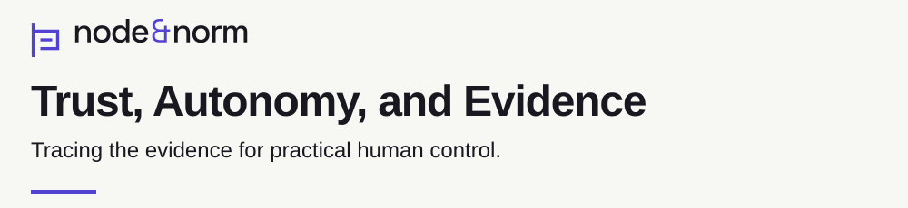

# Research identity assets

The reference banner gives each research entry a title, purpose and Node & Norm identity. The [generator](generate.py) uses the existing [Witness mark](../../brand/current/logo.svg) and [outlined wordmark](../../brand/current/banner.svg). Their shapes remain unchanged. [Palette tokens](tokens.json) supply the theme colors.

This draft contains the TAE reference assets. The [project configuration](tae.json) links the sources for its title, purpose and badge values. The organization profile and existing brand files retain their current form.

## Banner

<picture>
  <source media="(prefers-color-scheme: dark) and (max-width: 600px)" srcset="tae-banner-mobile-dark.svg">
  <source media="(max-width: 600px)" srcset="tae-banner-mobile-light.svg">
  <source media="(prefers-color-scheme: dark)" srcset="tae-banner-dark.svg">
  
</picture>

The [desktop configuration](tokens.json) uses a 1000 by 230 view box. The mobile version uses a 400 by 260 view box and explicit line breaks. Keep the title and purpose in ordinary README text as well.

Use the following markup when the versioned asset directory is local to the README. Preserve its source commit and [file hashes](manifest.json) when copying the bytes into another repository. Shared assets should change through a reviewed version update.

```html
<picture>
  <source media="(prefers-color-scheme: dark) and (max-width: 600px)" srcset="assets/research/v1/tae-banner-mobile-dark.svg">
  <source media="(max-width: 600px)" srcset="assets/research/v1/tae-banner-mobile-light.svg">
  <source media="(prefers-color-scheme: dark)" srcset="assets/research/v1/tae-banner-dark.svg">
  
</picture>
```

## Color and type

| Role | Light theme | Dark theme |
| --- | --- | --- |
| Background | Paper `#F7F7F4` | Carbon `#191820` |
| Text | Carbon `#191820` | Paper `#F7F7F4` |
| Links, mark and rules | Deep iris `#5142D3` | Light iris `#B5AFFF` |
| Decorative marker | Deep iris `#5142D3` | Citron `#D7F59A` |

These five colors are defined in [tokens.json](tokens.json). Citron and light iris remain off paper-colored body text. The [contrast calculation](contrast.json) checks each declared text and accent pair against a 4.5:1 threshold. The [generator](generate.py) records the calculation. Rendered page accessibility requires a separate review.

The title and purpose use Arial with Helvetica and sans-serif fallbacks. The [wordmark source](../../brand/README.md) retains its outlined Space Grotesk lettering. Its font license remains in the existing [brand directory](../../brand/current/SPACE-GROTESK-LICENSE.txt). This asset draft changes no license or trademark terms.

## Badges

Use a small row of metadata badges beneath the research question. Each badge must link to the source that establishes its value. The [TAE configuration](tae.json) supplies four examples:

| Label | Value | Meaning |
| --- | --- | --- |
| status | methods closed | The recorded methods phase has closed. |
| release | v0.18.0 | The repository release identity. |
| license | Apache-2.0 | The repository's stated license. |
| paper | 2026-11-01 | The editorial paper revision date. |

Each label has light and dark SVG variants in [badges](badges). A badge records its linked metadata. Claims about independent review, reliability, effective control or legal conformity require their own evidence.

## README hierarchy

Use one level-one research title in accessible text. Use level-two headings for the research question, reader paths, method, evidence, known limits, reproduction and citation. Use level-three headings only when a section needs subdivision. Give long technical records a descriptive details label. Preserve their source and version identities.

A method diagram should have at most eleven nodes. Label every edge and include an accessible title and description. Give the same reading path in prose. Link every factual statement to the record that supports it.

## Generate and check

Run these commands from the `.github` repository root with Python 3.9 or later. The generator uses the standard library. Generation writes the twelve SVG files, contrast receipt and manifest. Check mode reads the same inputs and compares the output bytes.

```sh
python3 assets/research/v1/generate.py
python3 assets/research/v1/generate.py --check
```

Expected output:

```text
14 generated files written.
14 generated files match.
```

The check parses each generated SVG and requires a title, description and image role. Inspect light, dark and mobile rendering before approving a repository integration.
