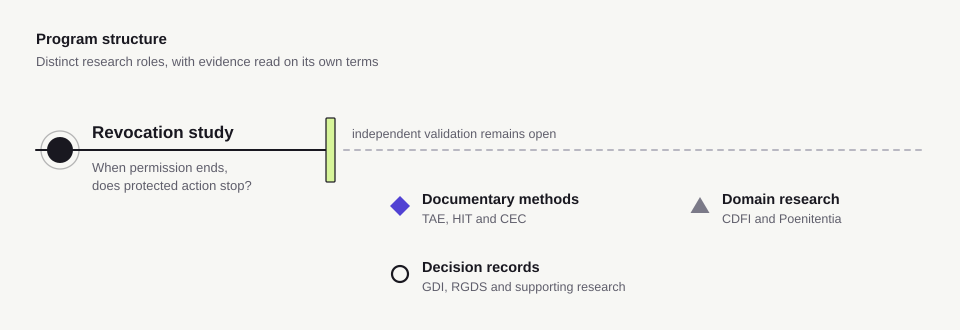

<h1></h1>

Node & Norm studies whether people can change the course of an AI-assisted decision and what evidence shows their intervention worked. Across eight projects, the program examines who can act, what the system does next and what an institution can explain to the people affected. [About the program](https://nodeandnorm.org/about#mission)

## Featured study

In two test scenarios, someone asked for work to stop and received no reply. In one, permission had ended and the action was denied. In the other, the request never arrived and the action went ahead. The record at the destination showed whether the action had happened.

The Revocation study used scripted workers and one local database. The November 24 closeout examined the saved records from six schedules run two ways. Further work on the other seven projects remains paused. [Read Essay 01](https://nodeandnorm.org/research/revocation/essay/) · [Explore the public study repository](https://github.com/node-and-norm/revocation-delegated-workflows)

<picture>
  <source media="(max-width: 600px)" srcset="https://raw.githubusercontent.com/node-and-norm/.github/main/profile/assets/program-structure-mobile.svg">
  
</picture>

## Start here

| You want to | Go to |
| :--- | :--- |
| Understand the Revocation study | [Read the Revocation essay](https://nodeandnorm.org/research/revocation/essay/), [see the study overview](https://nodeandnorm.org/research/#current-study) or [inspect the code and records](https://github.com/node-and-norm/revocation-delegated-workflows). |
| Inspect a method or implementation | [Repository directory](#repository-directory), with each project's retained evidence and limits |
| Read the argument first | [Essays](https://nodeandnorm.org/) and [program purpose](https://nodeandnorm.org/about) |
| Check how AI contributes | [Research practice](#research-practice) and each repository's disclosure |

## Where the evidence stops

The [research overview](https://nodeandnorm.org/research/#evidence) records what each of the eight projects can support. The counts below were checked against its project table on November 24, 2026.

| Kind of evidence | Held | Open |
| :--- | :--- | :--- |
| Method or specification written | 8 of 8 projects | 0 |
| Applied to cases or records | 6 of 7 | 1 |
| Agreement or software checks | 4 of 7 | 3 |
| Independent replication | 0 of 7 | 7 |
| Effect in a deployed setting | 0 of 8 | 8 |

Each denominator counts the projects designed to produce that kind of evidence. The overview identifies which entries are authored demonstrations and which are software checks. Independent replication and effects in deployed settings require evidence of their own.

HIT retains an earlier two-scorer exercise with 7/7 agreement under earlier rules. That is not independent replication under the current rules or evidence of general reliability. Its current candidate protocol prohibits scoring while its release gates remain unresolved.

## Repository directory

Each entry preserves its own methods, versions and research boundaries. This presentation changes no study approval, recruitment permission or maintenance commitment.

| Work | Retained contribution | What remains open |
| :--- | :--- | :--- |
| [Revocation in Delegated AI Workflows](https://github.com/node-and-norm/revocation-delegated-workflows) | Six fixed schedules, each run directly and through LangGraph. The requester saw the same silence in two scenarios. The destination recorded an action in one and none in the other. | Independent replication, behavior with live AI agents and performance in deployed systems |
| [Trust, Autonomy, and Evidence](https://github.com/node-and-norm/trust-autonomy-evidence) | Retrospective reconstruction method; three historical cases, all conditionally Unresolved | Independent reliability, validity and transfer to contemporary AI systems |
| [Human Influence Telemetry](https://github.com/node-and-norm/human-influence-telemetry) | Documentary scoring method; one preserved scoring exercise under earlier rules; maintenance | Current-protocol approval and independent replication. Candidate-protocol scoring remains prohibited. |
| [Control Evidence Corpus](https://github.com/node-and-norm/control-evidence-corpus) | Development record structure; three authored synthetic demonstrations | Empirical pilot, independent coding, validity and reliability |
| [Governed Decision Intelligence](https://github.com/node-and-norm/governed-decision-intelligence) | Specification and reference implementation; structure, routing and receipt-integrity checks | Factual truth, reviewer understanding and deployment effect. Upstream interoperability driver remains [in review](https://github.com/ScopeBlind/agent-governance-testvectors/pull/7). |
| [Regulated Gate Decision Support](https://github.com/node-and-norm/rgds) | Conditional-approval record format and validation tools; six illustrative records | Empirical evaluation, regulatory acceptance and workflow effect |
| [Catholic Doctrinal Fidelity Index](https://github.com/node-and-norm/cdfi-framework) | Provisional scoring rules and review procedures for SAICRED | Rule reconciliation and qualified theological validation |
| [Applied AI Research Translator](https://github.com/node-and-norm/applied-ai-research-translator) | Templates, bounded tasks and retained demonstrations | Independent evaluation and institutional benefit |
| [RGDS Independent Study](https://github.com/node-and-norm/rgds-independent-study) | Exploratory study of decision records in regulated drug development | Supporting records for retained quantitative claims and substantive review |
| [AI Assistance Governance](https://github.com/node-and-norm/rgds-ai-governance) | Working method for recording AI participation and the human basis for a decision | Empirical field evaluation |

The [Poenitentia Institutionum chapter](https://nodeandnorm.org/research/#poenitentia) has a public introduction. Its manuscript repository remains private.

## Review and reuse

Read the repository's limits, protocol status and source records before attempting a study. A public repository or research question is not permission to begin participant recruitment, scoring or a new experiment. Code checks, documentary review and independent empirical validation answer different questions.

For a reproducible software check, record the commit, environment, command and expected output specified by that repository. Preserve unexpected results and unresolved findings. Report a bounded documentation or software issue in the relevant repository without uploading confidential records.

## Releases and citation

Cite the specific work and version you used. Later commits can contain work outside a release.

| Work | Retained version | Citation record |
| --- | --- | --- |
| Revocation in Delegated AI Workflows | [Experimental software archive, November 18, 2026](https://github.com/node-and-norm/revocation-delegated-workflows/releases/tag/research-archive-2026-11-18) | [Software citation](https://github.com/node-and-norm/revocation-delegated-workflows/blob/main/CITATION.cff) · [November 24 study account](https://nodeandnorm.org/research/revocation/essay/) |
| Trust, Autonomy, and Evidence | [Software v0.18.0](https://github.com/node-and-norm/trust-autonomy-evidence/releases/tag/v0.18.0) | [CITATION.cff](https://github.com/node-and-norm/trust-autonomy-evidence/blob/main/CITATION.cff) |
| Human Influence Telemetry | [Software v0.6.7](https://github.com/node-and-norm/human-influence-telemetry/releases/tag/v0.6.7) | [CITATION.cff](https://github.com/node-and-norm/human-influence-telemetry/blob/main/CITATION.cff) |
| Governed Decision Intelligence | [v3.0](https://github.com/node-and-norm/governed-decision-intelligence/releases/tag/v3.0) | [CITATION.cff](https://github.com/node-and-norm/governed-decision-intelligence/blob/main/CITATION.cff) |
| Control Evidence Corpus | [Development v0.3.0-dev](https://github.com/node-and-norm/control-evidence-corpus/releases/tag/v0.3.0-dev) | [CITATION.cff](https://github.com/node-and-norm/control-evidence-corpus/blob/main/CITATION.cff) |
| Regulated Gate Decision Support | [Implementation v2.0.1](https://github.com/node-and-norm/rgds/releases/tag/v2.0.1) | [CITATION.cff](https://github.com/node-and-norm/rgds/blob/main/CITATION.cff) |
| Catholic Doctrinal Fidelity Index | [Archived v1.5](https://github.com/node-and-norm/cdfi-framework/releases/tag/v1.5) | [CITATION.cff](https://github.com/node-and-norm/cdfi-framework/blob/main/CITATION.cff) |

CEC also retains a separate [Catholic-pilot v0.4.1-dev prerelease](https://github.com/node-and-norm/control-evidence-corpus/releases/tag/catholic-pilot-v0.4.1-dev). That disclosure/readability update does not replace the infrastructure version above or establish a new experiment.

## Research practice

Mark Julius Banasihan works with AI agents on the program and is accountable for what is published. Read the [AI-use statement](https://nodeandnorm.org/about/research-integrity/#ai-use) alongside each repository's own disclosure and review records. An AI-assisted replay or review within the program is not independent external validation.

[Research integrity](https://nodeandnorm.org/about/research-integrity/) · [ORCID](https://orcid.org/0009-0001-8121-2878) · [Shared visual identity](https://github.com/node-and-norm/.github/blob/main/assets/brand/README.md)
