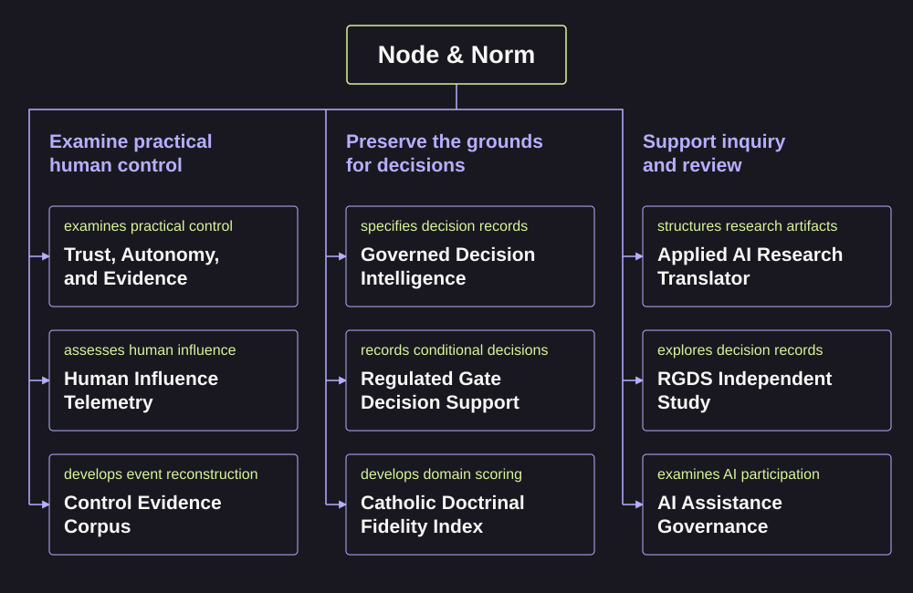
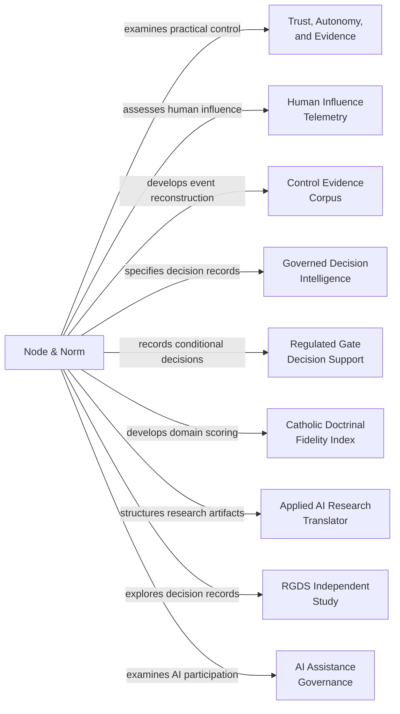

<h1>
<picture>
  <source media="(max-width: 600px)" srcset="https://raw.githubusercontent.com/node-and-norm/.github/cae1260c05b686a30f51580ae96ec705428c8535/assets/research/v1/projects/program/banner-mobile-dark.svg">
  
</picture>
</h1>

Node & Norm examines how people can retain practical control of AI-assisted decisions. The program develops methods for checking those claims against evidence as AI capabilities advance. [Mission](https://nodeandnorm.org/about).

[Policy reader: explore the questions](#research-themes) · [Reviewer: inspect evidence and limits](#flagship-repositories) · [Engineer: reproduce the checks](#run-and-verify)

## At a glance

| | Program entry |
| :--- | :--- |
| Purpose | Examine human authority, judgment and accountability through explicit research questions. [Mission](https://nodeandnorm.org/about) |
| Status | Independent research with project-specific evidence and open questions. [Research agenda](https://nodeandnorm.org/research-agenda) |
| Evidence type | Documentary studies, conceptual methods, software checks and labelled demonstrations. [Project directory](#flagship-repositories) |
| Version | Each repository preserves its own version history. [Version directory](#releases-and-citation-identities) |
| License | Read each repository's license and source-specific rights record. [Project directory](#flagship-repositories) |
| Cite | Cite the specific work and version used. [Citation route](#cite-the-work-you-use) |

## Research themes

### Examine practical human control

What evidence shows that a person could understand, question or change a consequential decision? [Trust, Autonomy, and Evidence](https://github.com/node-and-norm/trust-autonomy-evidence), [Human Influence Telemetry](https://github.com/node-and-norm/human-influence-telemetry) and the [Control Evidence Corpus](https://github.com/node-and-norm/node-norm-control-evidence) examine different parts of that question.

### Preserve the grounds for decisions

How can a record connect evidence, authority and unresolved conditions? [Governed Decision Intelligence](https://github.com/node-and-norm/governed-decision-intelligence) and [Regulated Gate Decision Support](https://github.com/node-and-norm/rgds) develop decision structures. The [Catholic Doctrinal Fidelity Index](https://github.com/node-and-norm/cdfi-framework) examines scoring and review within a specific domain.

### Support inquiry and review

The supporting repositories explore [research-to-decision workflows](https://github.com/node-and-norm/applied-ai-research-translator), [regulated drug-development decisions](https://github.com/node-and-norm/rgds-independent-study) and [AI participation in human decisions](https://github.com/node-and-norm/rgds-ai-governance). Each retains its own method, evidence boundary and revision history.

## Repository map

This directory groups repositories by their stated purpose. Its connections describe research roles. Each project's evidence requires separate assessment. [Control methods](https://github.com/node-and-norm/trust-autonomy-evidence), [decision structures](https://github.com/node-and-norm/governed-decision-intelligence), [domain evaluation](https://github.com/node-and-norm/cdfi-framework).

<picture>
  <source media="(max-width: 600px)" srcset="https://raw.githubusercontent.com/node-and-norm/.github/c7ad6b9ae6b4d007bef1a416e17c20338cc49cce/assets/research/v1/repository-map/map-mobile-dark.svg">
  
</picture>

Diagram source and alternative Mermaid view

The text equivalent is the three research themes above and the project tables below. A link between projects leaves cross-validation, integration and institutional effectiveness to their own evidence. [Program approach](https://nodeandnorm.org/about).

## Flagship repositories

| Repository | Contribution | Evidence boundary |
| :--- | :--- | :--- |
| [Trust, Autonomy, and Evidence](https://github.com/node-and-norm/trust-autonomy-evidence) | A retrospective method for examining practical human control. | Historical source packets and explicit uncertainty; general validity remains open. [Research account](https://github.com/node-and-norm/trust-autonomy-evidence/blob/main/RESEARCH_STATUS.md) |
| [Human Influence Telemetry](https://github.com/node-and-norm/human-influence-telemetry) | A documentary assessment of human authority and its exercise. | A bounded human scoring exercise, development cases and separate AI experiments. [Limits](https://github.com/node-and-norm/human-influence-telemetry/blob/main/LIMITATIONS.md) · [Experiment record](https://github.com/node-and-norm/human-influence-telemetry/blob/main/research/strengthening/passage-report.md) |
| [Governed Decision Intelligence](https://github.com/node-and-norm/governed-decision-intelligence) | A specification and reference implementation for decision records. | Fixtures and software checks leave deployment effectiveness open. [Claim register](https://github.com/node-and-norm/governed-decision-intelligence/blob/main/RESEARCH.md) |
| [Control Evidence Corpus](https://github.com/node-and-norm/node-norm-control-evidence) | Infrastructure for reconstructing control opportunities. | Synthetic demonstrations; the independent empirical pilot remains pending. [Research brief](https://github.com/node-and-norm/node-norm-control-evidence/blob/main/research/README.md) |
| [Regulated Gate Decision Support](https://github.com/node-and-norm/rgds) | Decision records for permission, conditions and follow-up. | Authored examples and selected validation rules; evaluation remains prospective. [Evaluation plan](https://github.com/node-and-norm/rgds/blob/main/evaluation/evaluation-plan.md) |
| [Catholic Doctrinal Fidelity Index](https://github.com/node-and-norm/cdfi-framework) | Evaluation rules and review procedures within SAICRED. | Provisional scoring; contract reconciliation and human theological review remain open. [Research account](https://github.com/node-and-norm/cdfi-framework/blob/main/docs/research-summary.md) |

## Supporting repositories

| Repository | Reader's entry |
| :--- | :--- |
| [Applied AI Research Translator](https://github.com/node-and-norm/applied-ai-research-translator) | Template-based research artifacts, retained demonstrations and explicit limits. [Limitations](https://github.com/node-and-norm/applied-ai-research-translator/blob/main/LIMITATIONS.md) |
| [RGDS Independent Study](https://github.com/node-and-norm/rgds-independent-study) | An exploratory study of decision records in regulated drug development. [Study entry](https://github.com/node-and-norm/rgds-independent-study/blob/main/README.md) |
| [AI Assistance Governance](https://github.com/node-and-norm/rgds-ai-governance) | A working method for recording AI participation and examining the human decision basis. [Method entry](https://github.com/node-and-norm/rgds-ai-governance/blob/main/README.md) |

## Releases and citation identities

These entries identify retained versions. Later repository commits can contain work outside a release. Read the linked citation record before reusing a result.

| Work | Retained version | Citation record |
| :--- | :--- | :--- |
| Trust, Autonomy, and Evidence | [Software v0.18.0](https://github.com/node-and-norm/trust-autonomy-evidence/releases/tag/v0.18.0) | [Software and preferred paper citation](https://github.com/node-and-norm/trust-autonomy-evidence/blob/main/CITATION.cff) |
| Human Influence Telemetry | [Software v0.6.7](https://github.com/node-and-norm/human-influence-telemetry/releases/tag/v0.6.7) | [Citation metadata](https://github.com/node-and-norm/human-influence-telemetry/blob/main/CITATION.cff) |
| Governed Decision Intelligence | [v3.0](https://github.com/node-and-norm/governed-decision-intelligence/releases/tag/v3.0) | [Citation metadata](https://github.com/node-and-norm/governed-decision-intelligence/blob/main/CITATION.cff) |
| Control Evidence Corpus | [Development v0.3.0-dev](https://github.com/node-and-norm/node-norm-control-evidence/releases/tag/v0.3.0-dev) | [Infrastructure citation](https://github.com/node-and-norm/node-norm-control-evidence/blob/main/CITATION.cff) |
| Regulated Gate Decision Support | [Implementation v2.0.1](https://github.com/node-and-norm/rgds/releases/tag/v2.0.1) | [Implementation citation](https://github.com/node-and-norm/rgds/blob/main/CITATION.cff) |
| Catholic Doctrinal Fidelity Index | [Archived v1.5](https://github.com/node-and-norm/cdfi-framework/releases/tag/v1.5) | [Archived citation](https://github.com/node-and-norm/cdfi-framework/blob/main/CITATION.cff) |

## Run and verify

Choose a repository, record the version or commit, and follow its reproduction instructions. The flagship READMEs provide an engineer's entry to exact commands and expected outputs. Preserve the stated environment and distinguish software checks from source review. [TAE reproduction](https://github.com/node-and-norm/trust-autonomy-evidence), [HIT validation](https://github.com/node-and-norm/human-influence-telemetry), [CEC reproduction](https://github.com/node-and-norm/node-norm-control-evidence).

## Cite the work you use

Use the repository's `CITATION.cff` and version-specific citation. When discussing the program as a whole, link the [mission](https://nodeandnorm.org/about), record the access date and identify the particular research artifacts behind your claim. The [project citation records](#releases-and-citation-identities) preserve their separate authorship and publication identities.

## Research practice

AI roles, human verification and unresolved checks require project-specific disclosure. Author acceptance and successful software checks have distinct evidentiary scopes. Read the [program's AI-use statement](https://nodeandnorm.org/about/research-integrity/#ai-use) alongside each repository's disclosure and source-review records.

[Research agenda](https://nodeandnorm.org/research-agenda) · [Research integrity](https://nodeandnorm.org/about/research-integrity/) · [ORCID](https://orcid.org/0009-0001-8121-2878)

Prior organization entry and shared design assets

The [complete prior profile](https://github.com/node-and-norm/.github/blob/51ad7bf38d11894a47da5f7f8446b9c2ea290f8b/profile/README.md) preserves the entry at [audit commit 51ad7bf](https://github.com/node-and-norm/.github/tree/51ad7bf38d11894a47da5f7f8446b9c2ea290f8b). The [shared design guide](https://github.com/node-and-norm/.github/blob/cae1260c05b686a30f51580ae96ec705428c8535/assets/research/v1/README.md) documents the palette, banners, badges and reproducible asset sources.

