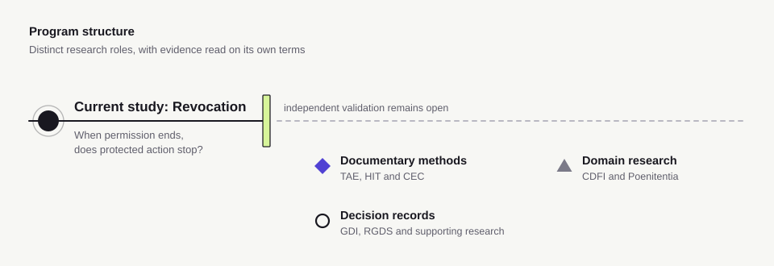

<h1>
<picture>
  <source media="(max-width: 600px)" srcset="https://raw.githubusercontent.com/node-and-norm/.github/cae1260c05b686a30f51580ae96ec705428c8535/assets/research/v1/projects/program/banner-mobile-dark.svg">
  
</picture>
</h1>

Research on whether claims of human control over AI-assisted decisions can be checked.

> **The question this program asks.** When an AI-assisted decision is said to remain under human control, what evidence shows that a person could intervene, and that the evaluation would detect a control failure?

<picture>
  <source media="(max-width: 600px)" srcset="https://raw.githubusercontent.com/node-and-norm/.github/main/profile/assets/program-structure-mobile.svg">
  
</picture>

## Start here

| You want to | Go to |
| :--- | :--- |
| Understand the current study | Revocation in delegated AI workflows: [public research overview](https://nodeandnorm.org/research). The study repository remains private; no public replication package is offered here. |
| Inspect a method or implementation | [Repository directory](#repository-directory), with each project's retained evidence and limits |
| Read the argument first | [Essays](https://nodeandnorm.org/) and [program purpose](https://nodeandnorm.org/about) |
| Check how AI contributes | [Research practice](#research-practice) and each repository's disclosure |

## Where the evidence stops

The [eight-project research overview](https://nodeandnorm.org/research) distinguishes five kinds of evidence. Its recorded counts, checked 11 November 2026, are:

| Kind of evidence | Held | Open |
| :--- | :--- | :--- |
| Method or specification written | 8 of 8 projects | 0 |
| Applied to cases or records | 6 of 7 | 1 |
| Agreement or software checks | 4 of 7 | 3 |
| Independent replication | 0 of 7 | 7 |
| Effect in a deployed setting | 0 of 8 | 8 |

These counts cover the projects designed to admit each kind of evidence, not the number of GitHub repositories. They include authored demonstrations and bounded software checks where labeled. A held cell does not establish evidence in another column.

HIT retains an earlier two-scorer exercise with 7/7 agreement under earlier rules. That is not independent replication under the current rules or evidence of general reliability. Its current candidate protocol prohibits scoring while its release gates remain unresolved.

## Repository directory

Each entry preserves its own methods, versions and research boundaries. This presentation changes no study approval, recruitment permission or maintenance commitment.

| Work | Retained contribution | What remains open |
| :--- | :--- | :--- |
| [Trust, Autonomy, and Evidence](https://github.com/node-and-norm/trust-autonomy-evidence) | Retrospective reconstruction method; three historical cases, all conditionally Unresolved | Independent reliability, validity and transfer to contemporary AI systems |
| [Human Influence Telemetry](https://github.com/node-and-norm/human-influence-telemetry) | Documentary scoring method; one preserved scoring exercise under earlier rules; maintenance | Current-protocol approval and independent replication. Candidate-protocol scoring remains prohibited. |
| [Control Evidence Corpus](https://github.com/node-and-norm/control-evidence-corpus) | Development record structure; three authored synthetic demonstrations | Empirical pilot, independent coding, validity and reliability |
| [Governed Decision Intelligence](https://github.com/node-and-norm/governed-decision-intelligence) | Specification and reference implementation; structure, routing and receipt-integrity checks | Factual truth, reviewer understanding and deployment effect. Upstream interoperability driver remains [in review](https://github.com/ScopeBlind/agent-governance-testvectors/pull/7). |
| [Regulated Gate Decision Support](https://github.com/node-and-norm/rgds) | Conditional-approval record format and validation tools; six illustrative records | Empirical evaluation, regulatory acceptance and workflow effect |
| [Catholic Doctrinal Fidelity Index](https://github.com/node-and-norm/cdfi-framework) | Provisional scoring rules and review procedures for SAICRED | Rule reconciliation and qualified theological validation |
| [Applied AI Research Translator](https://github.com/node-and-norm/applied-ai-research-translator) | Templates, bounded tasks and retained demonstrations | Independent evaluation and institutional benefit |
| [RGDS Independent Study](https://github.com/node-and-norm/rgds-independent-study) | Exploratory study of decision records in regulated drug development | Supporting records for retained quantitative claims and substantive review |
| [AI Assistance Governance](https://github.com/node-and-norm/rgds-ai-governance) | Working method for recording AI participation and the human basis for a decision | Empirical field evaluation |

The current revocation study and Poenitentia Institutionum chapter are described in the public research overview; their private repositories are not linked here.

## Review and reuse

Read the repository's limits, protocol status and source records before attempting a study. A public repository or research question is not permission to begin participant recruitment, scoring or a new experiment. Code checks, documentary review and independent empirical validation answer different questions.

For a reproducible software check, record the commit, environment, command and expected output specified by that repository. Preserve unexpected results and unresolved findings. Report a bounded documentation or software issue in the relevant repository without uploading confidential records.

## Releases and citation

Cite the specific work and version you used. Later commits can contain work outside a release.

| Work | Retained version | Citation record |
| --- | --- | --- |
| Trust, Autonomy, and Evidence | [Software v0.18.0](https://github.com/node-and-norm/trust-autonomy-evidence/releases/tag/v0.18.0) | [CITATION.cff](https://github.com/node-and-norm/trust-autonomy-evidence/blob/main/CITATION.cff) |
| Human Influence Telemetry | [Software v0.6.7](https://github.com/node-and-norm/human-influence-telemetry/releases/tag/v0.6.7) | [CITATION.cff](https://github.com/node-and-norm/human-influence-telemetry/blob/main/CITATION.cff) |
| Governed Decision Intelligence | [v3.0](https://github.com/node-and-norm/governed-decision-intelligence/releases/tag/v3.0) | [CITATION.cff](https://github.com/node-and-norm/governed-decision-intelligence/blob/main/CITATION.cff) |
| Control Evidence Corpus | [Development v0.3.0-dev](https://github.com/node-and-norm/control-evidence-corpus/releases/tag/v0.3.0-dev) | [CITATION.cff](https://github.com/node-and-norm/control-evidence-corpus/blob/main/CITATION.cff) |
| Regulated Gate Decision Support | [Implementation v2.0.1](https://github.com/node-and-norm/rgds/releases/tag/v2.0.1) | [CITATION.cff](https://github.com/node-and-norm/rgds/blob/main/CITATION.cff) |
| Catholic Doctrinal Fidelity Index | [Archived v1.5](https://github.com/node-and-norm/cdfi-framework/releases/tag/v1.5) | [CITATION.cff](https://github.com/node-and-norm/cdfi-framework/blob/main/CITATION.cff) |

CEC also retains a separate [Catholic-pilot v0.4.1-dev prerelease](https://github.com/node-and-norm/control-evidence-corpus/releases/tag/catholic-pilot-v0.4.1-dev). That disclosure/readability update does not replace the infrastructure version above or establish a new experiment.

## Research practice

Mark Julius Banasihan works with AI agents on the program and is accountable for what is published. Read the [AI-use statement](https://nodeandnorm.org/about/research-integrity/#ai-use) alongside each repository's own disclosure and review records. An AI-assisted replay or review within the program is not independent external validation.

[Research integrity](https://nodeandnorm.org/about/research-integrity/) · [ORCID](https://orcid.org/0009-0001-8121-2878) · [Shared visual identity](https://github.com/node-and-norm/.github/blob/main/assets/research/v1/README.md)
